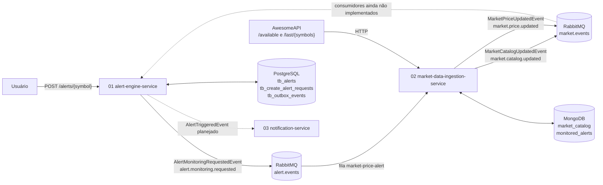
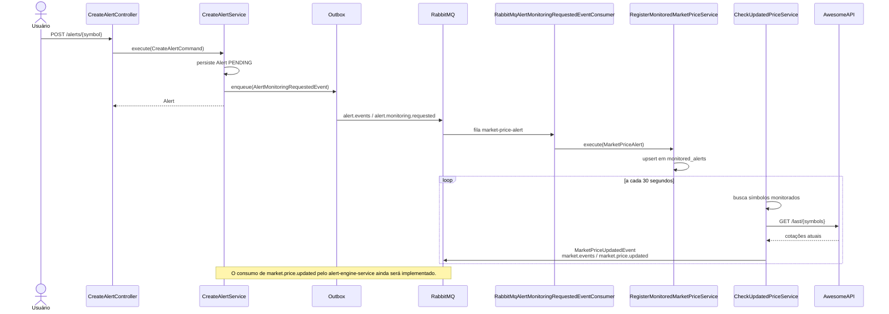

# FinAlert — Documentação de Arquitetura da Solução

## 1. Visão geral

O **FinAlert** é uma plataforma orientada a eventos para cadastrar alertas de preço, monitorar cotações de mercado e, futuramente, notificar usuários quando as condições configuradas forem satisfeitas.

Este documento distingue o que está implementado atualmente do que ainda está planejado. Os nomes dos eventos, exchanges, routing keys, filas, endpoints e métodos abaixo refletem o código e os arquivos `application-local.yaml` dos serviços.

## 2. Arquitetura atual



O `01-alert-engine-service` persiste o alerta e o evento de integração na mesma transação por meio do transactional outbox. O worker do outbox publica `AlertMonitoringRequestedEvent` em `alert.events` com a routing key `alert.monitoring.requested`.

O `02-market-data-ingestion-service` consome esse evento pela fila `market-price-alert`, mantém a projeção `monitored_alerts`, consulta a AwesomeAPI e publica atualizações em `market.events`.

Os consumidores de `market.catalog.updated` e `market.price.updated` no `01-alert-engine-service` ainda não estão implementados.

### 2.1. Sequência implementada



### 2.2. Métodos de entrada atuais

| Entrada | Método chamado | Responsabilidade |
|---|---|---|
| `POST /alerts/{symbol}` | `CreateAlertService.execute(CreateAlertCommand)` | Cria o alerta idempotentemente e enfileira `AlertMonitoringRequestedEvent` no outbox. |
| `alert.monitoring.requested` | `RabbitMqAlertMonitoringRequestedEventConsumer.consume(AlertMonitoringRequestedEvent)` | Converte o evento e chama o caso de uso de registro. |
| Registro do monitoramento | `RegisterMonitoredMarketPriceService.execute(MarketPriceAlert)` | Faz upsert do alerta monitorado no MongoDB. |
| Scheduler de catálogo | `RefreshMarketCatalogService.execute()` | Atualiza `market_catalog` e publica `MarketCatalogUpdatedMessage`. |
| Scheduler de cotações | `CheckUpdatedPriceService.execute()` | Consulta cotações e publica `MarketPriceUpdatedEvent`. |

## 3. Microsserviços

### 3.1. `01-alert-engine-service`

Responsabilidades implementadas:

1. Expõe `POST /alerts/{symbol}`.
2. Exige o header `Idempotency-Key`.
3. Persiste alertas em `tb_alerts`.
4. Controla idempotência em `tb_create_alert_requests`.
5. Persiste eventos em `tb_outbox_events` na mesma transação do alerta.
6. Publica `AlertMonitoringRequestedEvent` de forma assíncrona.
7. Aplica retry persistente, limite de tentativas e circuit breaker na publicação.

Ainda não implementado:

- consumo de `MarketCatalogUpdatedMessage`;
- consumo de `MarketPriceUpdatedEvent`;
- avaliação e disparo do alerta;
- `AlertMonitoringReleasedEvent`;
- `AlertTriggeredEvent`.

### 3.2. `02-market-data-ingestion-service`

Responsabilidades implementadas:

1. Consome `AlertMonitoringRequestedEvent`.
2. Mantém a projeção `monitored_alerts` no MongoDB.
3. Atualiza `market_catalog` a partir de `GET /available` da AwesomeAPI.
4. Publica `MarketCatalogUpdatedMessage`.
5. Consulta `GET /last/{symbols}` para os símbolos monitorados.
6. Publica um `MarketPriceUpdatedEvent` para cada cotação recebida.

Ainda não implementado:

- persistência de `market_quotes`;
- consumo de `AlertMonitoringReleasedEvent`;
- remoção do monitoramento após disparo ou cancelamento do alerta.

### 3.3. `03-notification-service`

O módulo existe e possui dependências para RabbitMQ e e-mail, mas o consumo de `AlertTriggeredEvent` e o envio da notificação ainda não estão implementados.

## 4. Contratos de eventos implementados

### 4.1. `AlertMonitoringRequestedEvent`

- **Produtor:** `01-alert-engine-service`
- **Exchange:** `alert.events`
- **Routing key:** `alert.monitoring.requested`
- **Consumidor:** `02-market-data-ingestion-service`
- **Fila:** `market-price-alert`
- **Semântica:** informa que um alerta ativo precisa ter seu símbolo monitorado. O consumidor faz upsert por `alertId`.

```json
{
  "eventId": "9296af84-0c44-43df-9b61-62d8534ecddd",
  "alertId": "8f8373b0-2b1b-4f81-80d5-12a8a7051b9e",
  "symbol": "USD-BRL",
  "targetValue": 5.6000,
  "triggerOperator": "GTE",
  "occurredAt": "2026-10-02T10:00:00Z"
}
```

### 4.2. `MarketCatalogUpdatedMessage`

- **Produtor:** `02-market-data-ingestion-service`
- **Exchange:** `market.events`
- **Routing key:** `market.catalog.updated`
- **Consumidor atual:** nenhum
- **Semântica:** representa um snapshot versionado do catálogo disponível no serviço de ingestão.

```json
{
  "eventId": "426c7962-d29e-4fa1-9d6c-294fb15e8f48",
  "catalog": {
    "USD-BRL": "Dólar Americano/Real Brasileiro",
    "BTC-BRL": "Bitcoin/Real Brasileiro"
  },
  "updatedAt": "2026-10-01T10:00:00Z",
  "version": 0
}
```

### 4.3. `MarketPriceUpdatedEvent`

- **Produtor:** `02-market-data-ingestion-service`
- **Exchange:** `market.events`
- **Routing key:** `market.price.updated`
- **Consumidor atual:** nenhum
- **Semântica:** representa a cotação mais recente de um único símbolo.

```json
{
  "eventId": "123e4567-e89b-12d3-a456-426614174000",
  "symbol": "USD-BRL",
  "currentPrice": 5.6025,
  "occurredAt": "2026-09-29T10:00:00Z"
}
```

## 5. Contratos planejados

Os contratos abaixo descrevem a evolução pretendida, mas ainda não possuem produtor e consumidor completos no código atual:

| Evento | Exchange | Routing key | Finalidade |
|---|---|---|---|
| `AlertMonitoringReleasedEvent` | `alert.events` | `alert.monitoring.released` | Encerrar o monitoramento depois do disparo ou cancelamento. |
| `AlertTriggeredEvent` | `alert.events` | `alert.triggered` | Solicitar a entrega da notificação ao usuário. |

## 6. Persistência atual

### 6.1. MongoDB — `02-market-data-ingestion-service`

- `market_catalog`: snapshot atual do catálogo, identificado por `_id = "current"`;
- `monitored_alerts`: projeção dos alertas recebidos por `AlertMonitoringRequestedEvent`, identificada por `alertId`.

Não existe atualmente uma collection persistente de histórico ou de última cotação.

### 6.2. PostgreSQL — `01-alert-engine-service`

- `tb_alerts`: alertas cadastrados;
- `tb_create_alert_requests`: controle de idempotência das requisições;
- `tb_outbox_events`: eventos pendentes, publicados ou definitivamente falhos.

Ainda não existe a projeção `tb_available_market_pairs`; ela deverá ser criada junto com o consumidor de `MarketCatalogUpdatedMessage`.

## 7. Tecnologias atuais

- Java 21;
- Spring Boot 4.x;
- Spring Data JPA e Hibernate;
- Spring Data MongoDB;
- PostgreSQL 17;
- MongoDB 8;
- RabbitMQ 4;
- Resilience4j;
- Flyway;
- Docker e Docker Compose.
