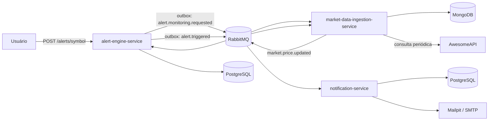

# FinAlert — Arquitetura da solução

## 1. Visão geral

O FinAlert é uma solução orientada a eventos que cadastra alertas de preço, monitora cotações e envia e-mails quando uma condição é satisfeita. A solução é formada por três serviços, RabbitMQ, PostgreSQL, MongoDB e um servidor SMTP local (Mailpit).

## 2. Fluxo completo



Sequência principal:

1. O usuário cria um alerta com `Idempotency-Key`.
2. O `alert-engine-service` persiste o alerta e `AlertMonitoringRequestedEvent` na mesma transação.
3. O `market-data-ingestion-service` registra o alerta em `monitored_alerts` por `alertId`.
4. O scheduler consulta uma cotação por símbolo monitorado e publica `MarketPriceUpdatedEvent` com publisher confirm.
5. O `alert-engine-service` bloqueia os alertas `PENDING` do símbolo, avalia a condição e, para cada correspondência, persiste `TRIGGERED` e `AlertTriggeredEvent` na mesma transação.
6. O `notification-service` consome `AlertTriggeredEvent`, deduplica por `eventId`/`alertId` e envia o e-mail.
7. Em outra fila, o `market-data-ingestion-service` consome o mesmo `AlertTriggeredEvent` e remove o alerta de `monitored_alerts`.

## 3. Serviços

### 3.1. `01-alert-engine-service`

Responsabilidades:

- expor `POST /alerts/{symbol}`;
- validar símbolos contra a projeção local do catálogo;
- criar alertas idempotentemente;
- consumir snapshots do catálogo e cotações;
- avaliar `GTE`, `LTE`, `GT`, `LT`, `EQ` e `NEQ` com `BigDecimal.compareTo`;
- realizar a transição `PENDING → TRIGGERED` uma única vez;
- publicar eventos com transactional outbox PostgreSQL.

Concorrência e idempotência:

- `tb_create_alert_requests` impede que uma chave idempotente crie dois alertas;
- a busca dos alertas pendentes usa lock pessimista dentro da transação;
- uma reentrega de cotação não reencontra o alerta depois da transição;
- estado do alerta e `AlertTriggeredEvent` são confirmados atomicamente.

### 3.2. `02-market-data-ingestion-service`

Responsabilidades:

- consumir `AlertMonitoringRequestedEvent` e fazer upsert por `alertId`;
- atualizar o catálogo da AwesomeAPI usando outbox Mongo transacional;
- consultar somente símbolos que possuem alertas monitorados;
- publicar uma cotação por símbolo com publisher confirm;
- consumir `AlertTriggeredEvent` e remover o alerta monitorado por `alertId`.

Não há outbox para cotações porque o polling não altera um estado local que precise ser confirmado atomicamente com a publicação. Uma falha de publicação interrompe o ciclo e a cotação será consultada novamente no próximo ciclo. A atualização do catálogo possui outbox porque catálogo e evento precisam permanecer consistentes.

### 3.3. `03-notification-service`

Responsabilidades:

- consumir `AlertTriggeredEvent` em fila própria;
- montar e enviar um e-mail por SMTP;
- registrar eventos processados em `tb_processed_notifications`;
- ignorar reentregas pelo `eventId` e impedir dois envios para o mesmo `alertId`.

A inserção na inbox e o envio participam da mesma transação local. Se o envio lançar uma exceção, a inserção é revertida e o listener pode tentar novamente. Como SMTP não oferece chave idempotente, existe a janela inerente de uma falha de processo depois da aceitação SMTP e antes do commit; eliminar essa janela exigiria um provedor de e-mail com idempotency key.

## 4. Contratos de eventos

Todos os eventos são JSON persistente no RabbitMQ.

### 4.1. `AlertMonitoringRequestedEvent`

| Item | Valor |
|---|---|
| Exchange | `alert.events` |
| Routing key | `alert.monitoring.requested` |
| Fila | `market-price-alert` |
| Produtor | `alert-engine-service` |
| Consumidor | `market-data-ingestion-service` |

```json
{
  "eventId": "9296af84-0c44-43df-9b61-62d8534ecddd",
  "alertId": "8f8373b0-2b1b-4f81-80d5-12a8a7051b9e",
  "symbol": "USD-BRL",
  "targetValue": 5.60,
  "triggerOperator": "GTE",
  "occurredAt": "2026-10-29T12:00:00Z"
}
```

### 4.2. `MarketCatalogUpdatedEvent`

| Item | Valor |
|---|---|
| Exchange | `market.events` |
| Routing key | `market.catalog.updated` |
| Fila | `market-catalog-updated` |
| Produtor | `market-data-ingestion-service` |
| Consumidor | `alert-engine-service` |

### 4.3. `MarketPriceUpdatedEvent`

| Item | Valor |
|---|---|
| Exchange | `market.events` |
| Routing key | `market.price.updated` |
| Fila | `market-price-updated` |
| Produtor | `market-data-ingestion-service` |
| Consumidor | `alert-engine-service` |

```json
{
  "eventId": "123e4567-e89b-12d3-a456-426614174000",
  "symbol": "USD-BRL",
  "currentPrice": 5.20,
  "occurredAt": "2026-10-29T12:00:00Z"
}
```

### 4.4. `AlertTriggeredEvent`

| Item | Valor |
|---|---|
| Exchange | `alert.events` |
| Routing key | `alert.triggered` |
| Filas | `alert-triggered-notification`, `alert-triggered-monitoring-release` |
| Produtor | `alert-engine-service` |
| Consumidores | `notification-service`, `market-data-ingestion-service` |

```json
{
  "eventId": "7875bd82-58db-47ee-a7e6-180af95588ba",
  "alertId": "8f8373b0-2b1b-4f81-80d5-12a8a7051b9e",
  "userEmail": "user@example.com",
  "symbol": "USD-BRL",
  "targetPrice": 5.10,
  "triggerOperator": "GTE",
  "currentPrice": 5.20,
  "quotedAt": "2026-10-29T11:59:55Z",
  "occurredAt": "2026-10-29T12:00:00Z"
}
```

## 5. Resiliência

| Ponto | Estratégia |
|---|---|
| Criação do alerta | Chave idempotente persistente e hash da requisição |
| Eventos do alert engine | Transactional outbox, publisher confirms, retry exponencial e circuit breaker |
| Catálogo | Outbox Mongo, claim atômico, retry, redrive e retenção |
| Cotações | Publisher confirm; novo polling após falha |
| Consumidores | Validação, retry limitado e dead-letter queue `<fila>.dlq` |
| Disparo concorrente | Lock pessimista e estado `PENDING` como guarda |
| E-mail | Inbox PostgreSQL única por `eventId` e `alertId` |

## 6. Persistência

PostgreSQL do alert engine:

- `tb_alerts`;
- `tb_create_alert_requests`;
- `tb_outbox_events`;
- `tb_market_catalog`.

MongoDB da ingestão:

- `monitored_alerts`;
- `market_catalog`;
- `market_catalog_outbox`.

PostgreSQL de notificações:

- `tb_processed_notifications`.

O histórico de todas as cotações não é persistido: não é necessário para avaliar o preço atual e aumentaria armazenamento e complexidade operacional. Pode ser introduzido futuramente como uma projeção independente, sem alterar os contratos existentes.

## 7. Execução local

Pré-requisitos: Java 21 e Docker Compose.

```powershell
$env:JAVA_HOME = '<caminho-do-jdk-21>'
.\gradlew.bat clean build
docker compose -f compose.yaml up --build
```

Serviços locais:

| Serviço | Endereço |
|---|---|
| Alert engine | `http://localhost:8080` |
| Market data ingestion | `http://localhost:8081` |
| Notification service | `http://localhost:8082` |
| Mailpit | `http://localhost:8025` |
| RabbitMQ management | `http://localhost:15672` |

Exemplo de criação:

```bash
curl -X POST http://localhost:8080/alerts/USD-BRL \
  -H "Content-Type: application/json" \
  -H "Idempotency-Key: demo-alert-1" \
  -d '{"userEmail":"user@example.com","targetPrice":5.10,"triggerOperator":"GTE"}'
```

## 8. Evoluções independentes do fluxo principal

- endpoint de cancelamento, publicando um evento que também remova o monitoramento;
- provedor de e-mail com chave idempotente e rastreamento de entrega;
- observabilidade distribuída com trace ID nos eventos;
- projeção opcional de histórico de cotações.
