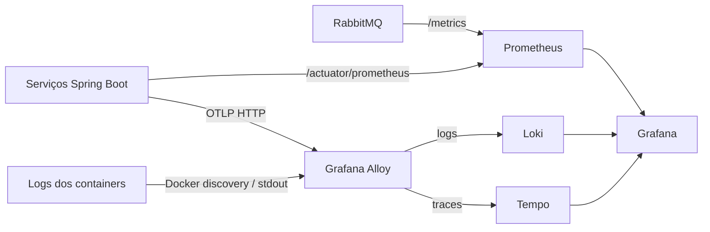

# FinAlert — Proposta de observabilidade

## 1. Objetivo

Esta proposta define como observar o FinAlert de ponta a ponta sem acoplar a lógica de negócio a um fornecedor específico. A solução deve permitir responder, com evidências:

- cada serviço está disponível e saudável?
- uma requisição ou evento está lento, falhando ou sendo repetido?
- em qual serviço, fila, banco ou integração ocorreu a falha?
- há eventos acumulados em outbox ou mensagens em dead-letter queues (DLQs)?
- o catálogo e as cotações continuam sendo atualizados?
- um alerta satisfeito produziu uma notificação, sem duplicidade?

Observabilidade possui três sinais complementares:

- **métricas** mostram tendências, capacidade, taxas e condições de alerta;
- **logs** explicam eventos discretos e falhas com contexto operacional;
- **traces** mostram a trajetória e a latência de uma operação distribuída.

## 2. Não objetivos

Esta etapa não pretende:

- substituir testes automatizados, auditoria de negócio ou persistência de domínio;
- armazenar payloads completos de eventos como telemetria;
- expor dados pessoais, credenciais ou conteúdo de e-mail em logs, métricas ou traces;
- introduzir uma plataforma de produção altamente disponível no ambiente local;
- instrumentar cada método da aplicação;
- criar dependência do domínio em Grafana, Prometheus, Loki, Tempo ou OpenTelemetry.

## 3. Estado atual

| Componente | Estado atual | Lacuna principal |
|---|---|---|
| `alert-engine-service` | Possui Spring Boot Actuator e logs em console | Não exporta métricas Prometheus nem traces |
| `market-data-ingestion-service` | Possui Actuator e endpoint `marketcatalogoutbox` | Resumo da outbox não é uma métrica consultável e alertável |
| `notification-service` | Possui logs em console | Não possui Actuator, métricas ou traces |
| RabbitMQ | Possui management UI e DLQs | Não é coletado centralmente pelo Prometheus |
| PostgreSQL e MongoDB | Possuem health checks do Compose | Sem painéis de capacidade ou desempenho |
| Docker Compose | Centraliza a execução local | Logs precisam ser consultados container por container |

Todos os serviços já definem `spring.application.name`, usam SLF4J e trocam mensagens pelo RabbitMQ. O fluxo principal também possui `eventId` e `alertId`, que são úteis para correlação em logs e investigação, mas não devem se tornar labels de métricas.

## 4. Decisão arquitetural

A stack local será formada por componentes open source, executados em containers e com versões fixadas:

| Componente | Responsabilidade |
|---|---|
| Grafana | Consulta, correlação, dashboards e alertas |
| Prometheus | Coleta e armazenamento de métricas |
| Loki | Armazenamento e consulta de logs |
| Tempo | Armazenamento e consulta de traces distribuídos |
| Grafana Alloy | Descoberta dos containers, coleta de logs e recepção/encaminhamento OTLP |

O uso de Alloy evita instalar agentes dentro das imagens das aplicações e mantém a coleta fora dos serviços. Prometheus continuará fazendo scrape dos endpoints HTTP; Alloy coletará stdout dos containers e receberá OTLP das aplicações.



### 4.1. Princípios da implementação

- falhas da stack de observabilidade nunca impedem o processamento de negócio;
- as aplicações usam Micrometer Observation e APIs do Spring, não APIs do backend;
- configurações comuns permanecem equivalentes nos três serviços;
- endpoints de gerenciamento não são publicados externamente em produção;
- telemetria usa nomes estáveis e labels de baixa cardinalidade;
- versões de imagens são fixadas; não se usa a tag `latest`;
- arquivos de provisionamento são versionados e a configuração do Grafana é reproduzível;
- o perfil local privilegia diagnóstico e amostragem completa; produção privilegia custo, segurança e retenção controlada.

## 5. Topologia local

Os componentes serão adicionados ao Compose raiz sob o profile `observability`. Assim, o fluxo funcional continua podendo ser executado sem a stack, e a observabilidade é habilitada explicitamente:

```bash
docker compose --profile observability up --build -d
```

Portas previstas no host, vinculadas a `127.0.0.1`:

| Componente | Porta | Uso |
|---|---:|---|
| Grafana | `3000` | Interface unificada |
| Prometheus | `9090` | Diagnóstico de scrape e PromQL |
| Loki | `3100` | API local; normalmente acessada pelo Grafana |
| Tempo | `3200` | API local; normalmente acessada pelo Grafana |
| Alloy | `12345` | Interface de diagnóstico do coletor |
| Alloy OTLP/HTTP | `4318` | Recepção de traces dentro da rede Compose |

Somente Grafana precisa ser usado rotineiramente. As demais portas existem para diagnóstico local e não constituem uma proposta de exposição em produção.

Volumes persistentes serão separados para Grafana, Prometheus, Loki e Tempo. `docker compose down` preserva telemetria; `docker compose down -v` remove todo o histórico local.

## 6. Instrumentação das aplicações

### 6.1. Dependências e endpoints

Os três serviços devem possuir:

- Spring Boot Actuator;
- registry Prometheus do Micrometer;
- starter OpenTelemetry do Spring Boot para tracing via OTLP.

O endpoint `/actuator/prometheus` será exposto para scrape somente na rede do Compose. `/actuator/health` continuará disponível para health checks. Endpoints mutáveis, como o redrive da outbox, não devem ser expostos à internet.

As aplicações receberão por configuração:

- nome do serviço, já definido em `spring.application.name`;
- ambiente (`local`, `staging` ou `production`);
- versão da aplicação;
- endpoint OTLP do Alloy;
- probabilidade de amostragem de traces.

### 6.2. RabbitMQ

A observação do `RabbitTemplate` e dos listener containers deve ser habilitada. Isso fornece métricas e spans com exchange, routing key, fila, resultado e duração, sem criar wrappers de infraestrutura desnecessários.

O contexto W3C será propagado nos headers AMQP. Para publicação direta, a instrumentação do Spring AMQP pode propagar o contexto ativo. Para transactional outbox, a publicação acontece depois da transação original e possivelmente em outra thread ou processo; portanto, o contexto precisa ser persistido junto ao evento:

1. capturar `traceparent` e, quando presente, `tracestate` ao criar a outbox;
2. armazenar os campos como opcionais no registro PostgreSQL ou documento MongoDB;
3. restaurar o contexto ao publicar e preencher os headers AMQP;
4. para registros antigos sem contexto, iniciar um novo trace e manter correlação por `eventId`.

Essa evolução deve ser compatível com registros existentes e não muda o payload público dos eventos.

### 6.3. Logs estruturados

As aplicações escreverão JSON ECS em stdout usando o suporte nativo do Spring Boot. Não serão gravados arquivos de log dentro dos containers. Alloy adicionará labels de infraestrutura, como serviço, container e ambiente, antes de enviar ao Loki.

Campos desejados:

- `service.name` e versão;
- ambiente;
- nível, logger e mensagem;
- `traceId` e `spanId`, fornecidos pelo MDC do tracing;
- `eventId` e `alertId` apenas quando relevantes à mensagem;
- tipo de evento e resultado da operação.

Regras:

- nunca registrar senha, token, connection string com credencial ou payload SMTP;
- não registrar `userEmail`; quando indispensável para suporte, usar identificador interno ou valor mascarado;
- evitar payload completo de eventos, pois `AlertTriggeredEvent` contém e-mail;
- exceções devem preservar stack trace, mas mensagens vindas de terceiros precisam de revisão para não vazar segredo;
- sucesso esperado usa `INFO`, situações recuperáveis usam `WARN` e falhas que exigem ação usam `ERROR`.

### 6.4. Traces

No ambiente local, a amostragem será `100%` para facilitar o diagnóstico. Produção começará com amostragem probabilística menor e configurável, por exemplo `10%`, sem recompilação.

Spans automáticos devem cobrir:

- requisições HTTP recebidas;
- clientes HTTP construídos pelos builders instrumentados do Spring;
- publicação e consumo RabbitMQ;
- operações de repositório suportadas pela instrumentação existente.

Spans customizados serão usados apenas em fronteiras que não ficam claras automaticamente:

- avaliação de alertas para uma cotação;
- claim e dispatch de outbox;
- atualização do catálogo;
- ciclo de obtenção e publicação de preços;
- envio da notificação.

Não se cria um span para cada entidade de um lote grande. O span do lote registra contagens e resultado, evitando volume excessivo.

## 7. Catálogo de métricas

Os nomes abaixo são nomes Micrometer. Na exposição Prometheus, pontos são convertidos em underscores e contadores recebem o sufixo apropriado.

### 7.1. Métricas automáticas

- JVM: heap, garbage collection, threads e classes;
- processo e sistema: CPU, uptime e file descriptors quando disponíveis;
- HTTP: volume, duração e resultado por rota normalizada;
- pools JDBC e conexões;
- observações de publicação e consumo RabbitMQ;
- health de dependências fornecido pelo Actuator.

### 7.2. Métricas de negócio e resiliência

| Métrica lógica | Tipo | Labels permitidas | Serviço |
|---|---|---|---|
| `finalert.alert.created` | Counter | `outcome`, `operator` | alert engine |
| `finalert.alert.condition.met` | Counter | `operator` | alert engine |
| `finalert.alert.cancelled` | Counter | `outcome` | alert engine, quando implementado |
| `finalert.outbox.events` | Gauge | `event.type`, `status` | alert engine e ingestão |
| `finalert.outbox.oldest.age` | Gauge | `event.type`, `status` | alert engine e ingestão |
| `finalert.outbox.publish` | Counter | `event.type`, `outcome` | alert engine e ingestão |
| `finalert.outbox.publish.duration` | Timer | `event.type`, `outcome` | alert engine e ingestão |
| `finalert.market.catalog.refresh` | Counter | `outcome` | ingestão |
| `finalert.market.catalog.age` | Gauge | nenhuma | ingestão |
| `finalert.market.price.fetch` | Counter | `outcome` | ingestão |
| `finalert.market.price.publish` | Counter | `outcome` | ingestão |
| `finalert.market.price.last.success.age` | Gauge | nenhuma | ingestão |
| `finalert.notification.process` | Counter | `outcome` | notification |
| `finalert.notification.send.duration` | Timer | `outcome` | notification |
| `finalert.notification.duplicate` | Counter | `reason` | notification |

Valores de `outcome`, `status`, `operator`, `event.type` e `reason` formam conjuntos pequenos e controlados. `symbol` não será label inicial: o catálogo pode crescer e essa dimensão pode ser investigada em logs e traces.

### 7.3. Infraestrutura e filas

O plugin Prometheus do RabbitMQ será habilitado. Os painéis acompanharão:

- mensagens prontas e não confirmadas por fila;
- taxa de publish, deliver, ack, nack e redelivery;
- consumidores ativos;
- conexões, canais, memória e alarmes;
- profundidade de cada DLQ.

Métricas internas de PostgreSQL e MongoDB por exporters dedicados ficam fora da primeira entrega. Health, latência percebida pela aplicação e pools de conexão cobrem o diagnóstico inicial com menos componentes. Exporters poderão ser adicionados quando houver requisito de capacidade, locks, queries lentas ou replicação.

## 8. Cardinalidade, correlação e privacidade

### 8.1. Labels de métricas

Labels precisam ter conjunto limitado. São proibidos como labels:

- `eventId`, `alertId` e idempotency key;
- e-mail;
- mensagens de exceção;
- URL completa com parâmetros;
- preço ou timestamp;
- símbolo sem uma análise explícita do tamanho máximo do catálogo.

IDs ficam em logs e traces, que são apropriados para busca pontual.

### 8.2. Correlação

- `traceId` correlaciona uma operação entre HTTP, RabbitMQ, logs e Tempo;
- `eventId` correlaciona entrega, redelivery e processamento idempotente;
- `alertId` correlaciona o ciclo de vida de um alerta;
- `Idempotency-Key` não deve ser registrada integralmente; quando necessário, usar hash ou prefixo seguro.

Grafana será provisionado para permitir navegação de logs Loki para um trace Tempo pelo `traceId`, e do trace para logs do mesmo serviço e intervalo.

### 8.3. Dados pessoais

E-mail é dado pessoal. Não será label, atributo de span ou campo de log. A telemetria também não armazenará corpo do e-mail nem payload completo de `AlertTriggeredEvent`. O banco continua sendo a fonte de verdade para dados de negócio permitidos.

## 9. Dashboards

### 9.1. Visão geral do FinAlert

- disponibilidade dos três serviços;
- taxa e latência HTTP;
- taxa de consumo e falhas por fila;
- alertas criados e condições satisfeitas;
- notificações enviadas e falhas;
- pendências, falhas e idade máxima das outboxes;
- profundidade das DLQs;
- idade da última atualização de catálogo e da última cotação bem-sucedida.

### 9.2. Serviços JVM

- heap e non-heap;
- pausas de GC;
- threads;
- CPU do processo;
- uptime;
- conexões JDBC e tempo de aquisição.

### 9.3. Mensageria e resiliência

- publish/deliver/ack/redelivery;
- consumidores por fila;
- retries e falhas de outbox;
- estado do circuit breaker do publisher;
- DLQs;
- latência dos listeners.

### 9.4. Logs e traces

- logs por serviço, nível e intervalo;
- erros recentes com `traceId` navegável;
- busca por `eventId` ou `alertId`;
- traces lentos e com erro;
- duração por etapa do fluxo distribuído.

## 10. Alertas iniciais

Os limiares começam conservadores e serão calibrados com uso real:

| Alerta | Condição inicial | Severidade |
|---|---|---|
| Serviço indisponível | scrape/health ausente por 2 minutos | crítica |
| DLQ não vazia | qualquer mensagem por 1 minuto | alta |
| Outbox falha | `FAILED > 0` | alta |
| Outbox envelhecida | evento pendente mais antigo acima de 1 minuto | alta |
| Outbox crescendo | crescimento contínuo por 5 minutos | média |
| Falha de notificação | aumento de falhas em 5 minutos | alta |
| Catálogo desatualizado | idade maior que o ciclo esperado mais tolerância | média |
| Preço desatualizado | nenhum sucesso para símbolos monitorados no período esperado | alta |
| Erros HTTP | taxa 5xx acima do limiar por 5 minutos | média |
| Latência HTTP | p95 acima do objetivo por 5 minutos | média |
| RabbitMQ sem consumidor | fila de negócio com zero consumidores | alta |

Na primeira entrega, os alertas aparecem no Grafana. Integrações externas de notificação de incidentes são uma evolução separada para evitar misturar alertas de mercado com alertas operacionais.

## 11. Segurança

### Ambiente local

- portas vinculadas somente a `127.0.0.1`;
- credenciais locais configuráveis por variáveis e nunca gravadas em dashboards;
- socket Docker montado como somente leitura no Alloy;
- acesso administrativo do Grafana com credencial local substituível;
- endpoints Actuator limitados ao conjunto necessário.

O acesso ao socket Docker é privilegiado mesmo quando o mount é read-only. Essa decisão é aceitável somente no ambiente de desenvolvimento controlado. Produção deverá usar integração compatível com seu orquestrador e política de segurança.

### Produção

- TLS e autenticação para ingestão e consulta;
- secrets em mecanismo próprio da plataforma;
- rede de gerenciamento separada;
- RBAC no Grafana;
- endpoints Actuator inacessíveis pela internet;
- políticas de retenção e backup;
- revisão de PII e redaction antes da promoção;
- limites de memória, CPU, disco e ingestão para a stack.

## 12. Retenção e capacidade

Valores locais iniciais:

| Sinal | Retenção proposta | Motivo |
|---|---:|---|
| Métricas Prometheus | 7 dias | suficiente para desenvolvimento e comparação recente |
| Logs Loki | 7 dias | diagnóstico sem crescimento indefinido |
| Traces Tempo | 3 dias | traces têm maior volume e valor principalmente recente |

Produção não herdará esses valores automaticamente. Retenção, armazenamento de objetos, replicação e backup serão dimensionados a partir de volume, SLO e requisitos legais.

## 13. Diferenças entre local e produção

| Aspecto | Local | Produção |
|---|---|---|
| Implantação | Docker Compose, instância única | plataforma gerenciada ou componentes HA |
| Sampling de traces | 100% | probabilístico ou tail sampling |
| Persistência | volumes Docker | armazenamento durável e, para Loki/Tempo, preferencialmente objetos |
| Autenticação | credencial local | SSO/RBAC e secrets gerenciados |
| Rede | loopback e rede Compose | segmentação e TLS |
| Alertas | Grafana local | roteamento operacional e escalonamento |
| Retenção | curta | definida por SLO, custo e compliance |

O Compose é uma topologia de desenvolvimento, não um blueprint de alta disponibilidade.

## 14. Estratégia incremental

### Fase 1 — Base e métricas

1. adicionar Actuator ao notification service;
2. adicionar registry Prometheus aos três serviços;
3. padronizar endpoints de health e métricas;
4. adicionar Prometheus e Grafana provisionado;
5. habilitar métricas do RabbitMQ;
6. criar dashboards de saúde, JVM, HTTP, RabbitMQ e DLQs.

### Fase 2 — Métricas de negócio e outbox

1. instrumentar contadores, timers e gauges listados neste documento;
2. substituir dependência operacional do endpoint `marketcatalogoutbox` por métricas, mantendo redrive administrativo;
3. criar alertas de outbox, catálogo, preço e notificação;
4. testar cardinalidade e comportamento sob retry.

### Fase 3 — Logs centralizados

1. habilitar JSON ECS em stdout;
2. adicionar Alloy e Loki;
3. provisionar datasource e consultas por serviço, nível, `eventId` e `alertId`;
4. validar redaction de PII e credenciais.

### Fase 4 — Tracing distribuído

1. adicionar starter OpenTelemetry e Tempo;
2. configurar OTLP para Alloy;
3. habilitar observação do RabbitTemplate e listeners;
4. persistir contexto W3C nas outboxes;
5. correlacionar logs e traces no Grafana;
6. validar o fluxo ponta a ponta e redeliveries.

Cada fase deve manter build, testes e fluxo funcional verdes. A stack pode ser entregue no mesmo ciclo de desenvolvimento, mas em commits pequenos e reversíveis conforme essas fronteiras.

## 15. Testes e critérios de aceite

### Testes automatizados

- context tests comprovam criação dos registries e configuração de observação;
- testes unitários validam métricas de negócio sem depender de Grafana;
- testes das outboxes validam captura e restauração opcional do contexto;
- testes garantem que falha de exportação OTLP não falha o caso de uso;
- testes de configuração verificam exposição somente dos endpoints esperados.

### Validação integrada

1. subir a solução com o profile `observability`;
2. confirmar todos os targets Prometheus em estado `UP`;
3. executar `source ./.finalert-test-functions.sh && finalert_run_e2e`;
4. localizar no Grafana as métricas do alerta criado e da notificação;
5. buscar logs do fluxo por `alertId` e `eventId`;
6. abrir o trace e navegar entre produção e consumo RabbitMQ;
7. confirmar ausência de e-mail e payload completo nos sinais;
8. republicar o evento e verificar idempotência e redelivery observável;
9. confirmar DLQs em zero;
10. parar Loki, Tempo ou Alloy e verificar que o fluxo de negócio continua funcionando.

Critérios mínimos de aceite:

- três serviços com health e métricas visíveis;
- logs dos três serviços consultáveis em um único lugar;
- traces HTTP e AMQP visíveis;
- dashboard de visão geral provisionado automaticamente;
- DLQs e outboxes monitoradas;
- nenhuma label de alta cardinalidade ou PII;
- documentação de execução e troubleshooting reproduzível;
- observabilidade indisponível não interrompe o FinAlert.

## 16. Operação e troubleshooting

Ordem recomendada de diagnóstico:

1. abrir o dashboard geral e identificar o primeiro sinal divergente;
2. conferir health e targets de scrape;
3. verificar filas, consumidores, DLQs e idade das outboxes;
4. abrir traces com erro ou lentos;
5. navegar para logs pelo `traceId`;
6. buscar `eventId` para analisar redelivery/idempotência;
7. usar logs diretos do Compose se a própria stack de observabilidade estiver indisponível.

Comandos de contingência continuam válidos:

```bash
docker compose ps
docker compose logs --tail=200 alert-engine market-data-ingestion notification
docker compose --profile observability logs --tail=200 grafana prometheus loki tempo alloy
```

Falhas comuns:

| Sintoma | Verificação |
|---|---|
| Target Prometheus `DOWN` | rede Compose, endpoint `/actuator/prometheus` e exposição Actuator |
| Sem logs no Loki | acesso read-only ao socket Docker, discovery e labels do Alloy |
| Sem traces | endpoint OTLP, sampling, pipeline Alloy e datasource Tempo |
| Trace interrompido na outbox | persistência/restauração de `traceparent` e headers AMQP |
| Dashboard vazio | datasource provisionado, nomes das métricas e intervalo de tempo |
| Disco crescendo | retenção, volume de logs, sampling e limites |

## 17. Referências oficiais

- [Spring Boot — Observability](https://docs.spring.io/spring-boot/reference/actuator/observability.html)
- [Spring Boot — Metrics](https://docs.spring.io/spring-boot/reference/actuator/metrics.html)
- [Spring Boot — Tracing](https://docs.spring.io/spring-boot/reference/actuator/tracing.html)
- [Spring Boot — Structured Logging](https://docs.spring.io/spring-boot/reference/features/logging.html#features.logging.structured)
- [Spring AMQP — Micrometer Observation](https://docs.spring.io/spring-amqp/reference/appendix/micrometer.html)
- [Grafana Alloy](https://grafana.com/docs/alloy/latest/)
- [Grafana Loki](https://grafana.com/docs/loki/latest/)
- [Grafana Tempo](https://grafana.com/docs/tempo/latest/)
- [Prometheus](https://prometheus.io/docs/introduction/overview/)
- [OpenTelemetry Protocol](https://opentelemetry.io/docs/specs/otlp/)
